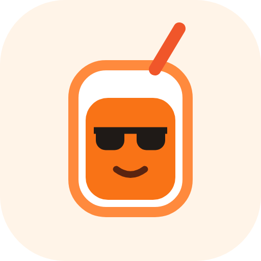

  

<h2 align="center">TimeStack</h2>

Your classes, tasks and study time, in one warm place.

  <a href="https://github.com/Beshoy-Wassef/installer/releases/latest/download/TimeStack.dmg"><b>Download for Mac</b></a>
  &nbsp;·&nbsp;
  <a href="https://github.com/Beshoy-Wassef/installer/releases/latest/download/TimeStack-Setup.exe"><b>Download for Windows</b></a>

### What is it?

- A calendar for every course, and one calendar that shows them all
- Syncs both ways with Google Calendar
- Schedule by typing: "Move my CS 101 lab to Friday at 2"
- Daily Tasks next to your calendar
- Study Mode with a focus timer, Sunny the orange juice, and your own music
- Works offline, with your data saved on your computer (or in your account when you sign in)

This repo only holds the installers. Each [release](https://github.com/Beshoy-Wassef/installer/releases) has the Mac app (one .dmg for Apple Silicon and Intel) and the Windows installer (Windows 10 and 11, 64-bit).

### Install

**Mac**

1. Open **TimeStack.dmg** and drag **TimeStack** into **Applications**.
2. Open TimeStack from Applications. The first time, your Mac asks whether to open an app downloaded from the internet: click **Open**.

**Windows**

1. Open **TimeStack-Setup.exe**.
2. If Windows says **"Windows protected your PC"**, click **More info**, then **Run anyway** (you only do this once). TimeStack installs in a few seconds, no administrator password needed.

### Updates

TimeStack checks for a new version when it opens and every few hours. When one is ready, it asks to restart; if you pick Later, it updates the next time you quit. Your courses, calendar and settings stay as they are.

On a Mac, TimeStack updates itself from the Applications folder. If you opened it straight from the .dmg, it shows a link to download the new version instead.
